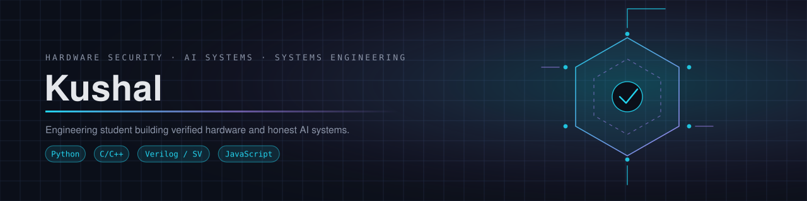

  

  <a href="https://github.com/kushalr5600-commits/blackbox">BLACKBOX</a> ·
  <a href="https://github.com/kushalr5600-commits/computational_rnd_engine">computational_rnd_engine</a> ·
  <a href="https://github.com/kushalr5600-commits/nexus-os">nexus-os</a> ·
  <a href="https://github.com/kushalr5600-commits/kkr">kkr</a> ·
  <a href="https://www.linkedin.com/in/kushal-kumar-r-73437143b">LinkedIn</a>

## About me

Engineering student building **verified hardware** and **honest AI systems** — solo, end to end.
My work sits at three intersections: post-quantum cryptography in RTL, CPU/GPU architecture
R&D, and decision-intelligence systems you can actually audit. I care less about demos that
pass and more about evidence that a claim is true — every project below states what is
verified, what is not, and where the boundaries are.

## Technology stack

**Languages**

**Hardware & EDA**

**Software & data**

## Featured projects

| Project | What it is | Highlights |
|:--|:--|:--|
| **[BLACKBOX](https://github.com/kushalr5600-commits/blackbox)** | Enterprise decision preflight engine — IBM Z Datathon 2026 | Impact Gate + counterfactual simulation + fragility search → Decision Certificate with evidence. Synthetic data only. |
| **[computational_rnd_engine](https://github.com/kushalr5600-commits/computational_rnd_engine)** | Self-improving CPU/GPU architecture R&D engine + **QuantumVault** | FIPS 203 (ML-KEM-768) keygen RTL verified byte-for-byte in simulation; OpenROAD/Sky130 flow; honest deterministic surrogate evaluator. |
| **[nexus-os](https://github.com/kushalr5600-commits/nexus-os)** | Universal agentic runtime for AI agents (experimental) | Kernel, DAG orchestration, MCP/A2A/ACP protocols, memory adapters, governance. Compiles on CPython 3.12; **not** production-ready. |
| **[kkr](https://github.com/kushalr5600-commits/kkr)** | BLACKBOX — IBM Z Datathon 2026 submission snapshot | The judged submission line (2026-10-18). Development continues in `blackbox`. |

## GitHub statistics

  
  

  

## Collaborate with me

Preparing for the **Scaler University DevForge Hackathon**. Open to collaboration on:

- Post-quantum hardware design and verification · CPU/GPU exploration tooling
- Decision-intelligence / agentic systems with honest evaluation

**Find me:** [LinkedIn](https://www.linkedin.com/in/kushal-kumar-r-73437143b) · open an issue or a discussion on any of my repositories — I read everything.

  Built solo. Verified where it matters. Documented where it doesn't.

